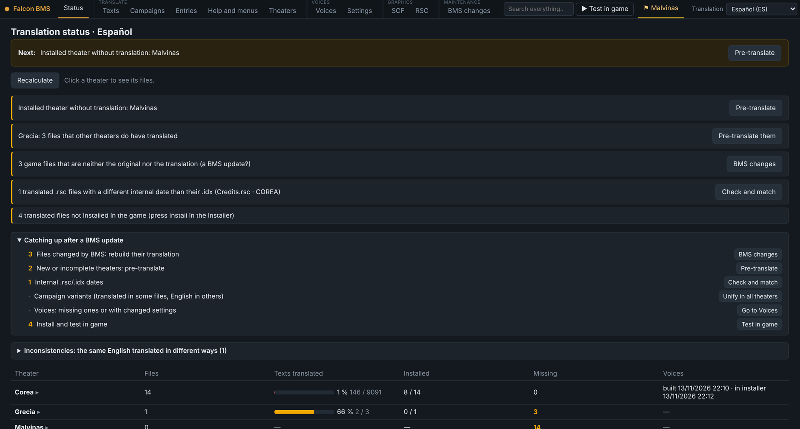
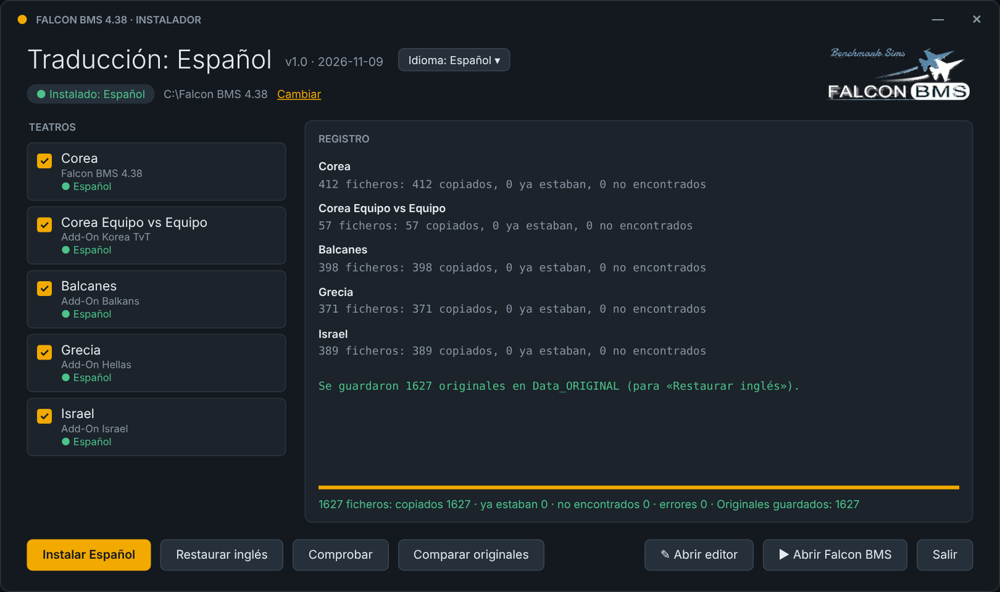
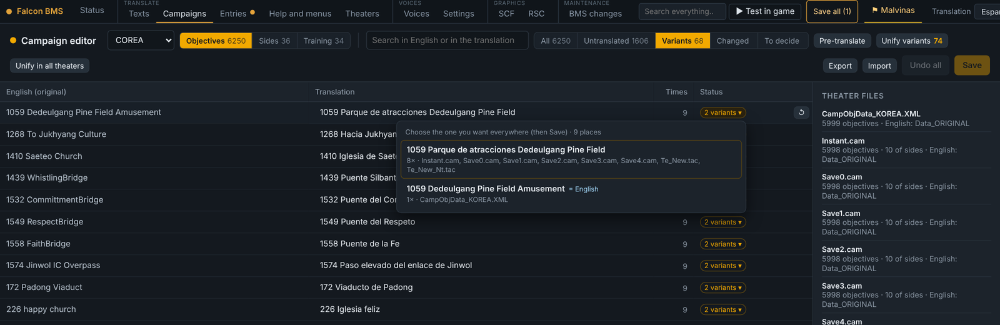
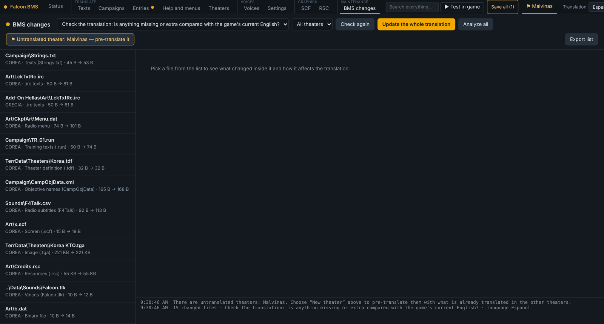
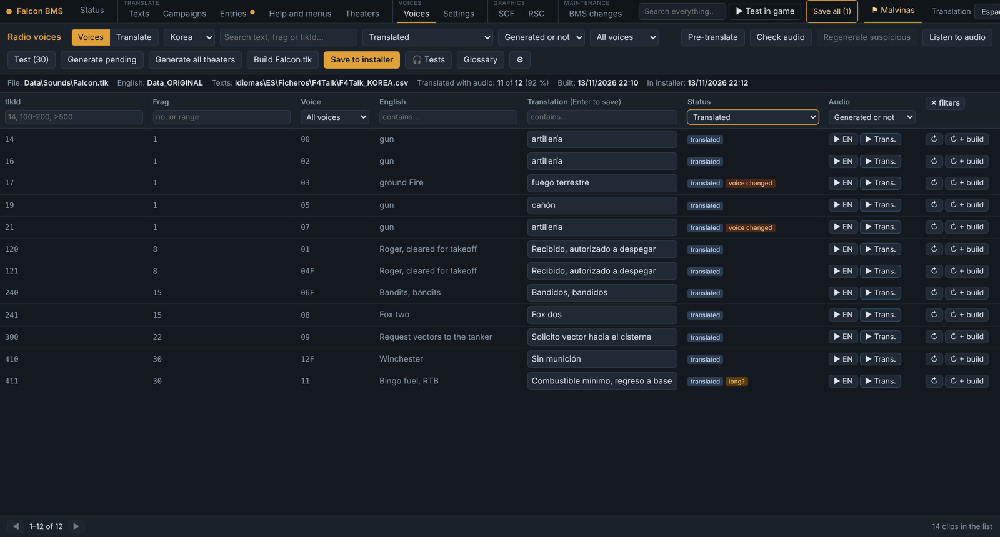
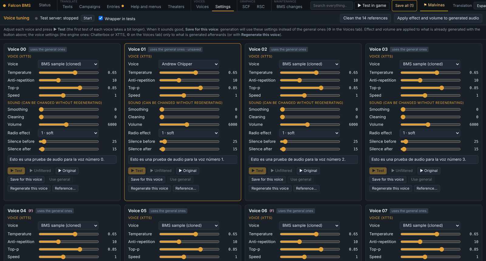

# Falcon BMS 4.38 translation tool

[Español](README.md) · **English**

Tools to translate **Falcon BMS 4.38** into any language and to install that translation in the game:

- **Installer:** puts a translation into Falcon BMS and takes it out again, theater by theater, without touching anything else in the game.
- **Editor:** creates and maintains the translation: menus, texts, database entries, campaigns, images and radio voices.

The package **includes no translation**. You create one with the editor or add a ready-made one to the `Idiomas` folder (see [Where each translation goes](#where-each-translation-goes)).

It works with the game's five theaters (**Korea**, **Korea Team vs Team**, **Balkans**, **Hellas** and **Israel**) and with any new theater installed as `Data\Add-On <Name>`, including those that use an `_NT` `.tdf` (for example, Mideast128).

The editor interface can be switched between Spanish and English (**ES | EN**). Folder and file names (`Idiomas`, `Ficheros`, `Respaldo`…) stay in Spanish.



---

## Contents

- [Requirements](#requirements)
- [What is in the package](#what-is-in-the-package)
- [Where each translation goes](#where-each-translation-goes)
- [Installer](#installer)
- [Editor](#editor)
- [When a BMS update comes out](#when-a-bms-update-comes-out)
- [A new theater](#a-new-theater-untranslated-add-on)
- [Radio voices](#radio-voices-optional)
- [Backups and machine-specific files](#backups-and-machine-specific-files)
- [Sharing your translation](#sharing-your-translation)
- [Licences and notices](#licences-and-notices)

---

## Requirements

- **Falcon BMS 4.38** installed.
- Windows 10 or 11 (uses PowerShell 5, included with Windows).
- Only to generate radio voices: an **NVIDIA** card with CUDA (8 GB or more recommended), about 8 GB free and internet the first time.

---

## What is in the package

```
├── Instalar.bat                  Opens the installer
├── LEEME.txt                     First steps (Spanish)
├── Instalador/
│   ├── Instalador.ps1            Installer (window)
│   ├── Idiomas.ps1               Translation languages (used by the installer and the editor)
│   ├── Teatros.ps1               Theaters: the known ones, any new «Add-On» and their folders from the .tdf
│   ├── logo.png                  Window logo (optional; can be replaced)
│   ├── Revisar_redundantes.bat   Lists translated files identical to the original
│   └── Retirar_redundantes.bat   Removes them from the language (with a backup)
└── Editor_BMS/
    ├── Editor_BMS.bat            Opens the editor
    ├── Crear_distribucion.bat    Creates the zip to share the tool with your translations
    ├── Crear_paquete.bat         Creates a zip with the editor only
    └── Voces/                    Radio voice kit (scripts and clip maps)
```

Using it also creates:

- `Idiomas\`: the translations (created by the editor or copied by you).
- `Data_ORIGINAL\`: the English originals of the translated files. The installer stores them the first time; they are used to go back to English.
- `Editor_BMS\Respaldo\`, `Editor_BMS\memoria_<LANGUAGE>.json` and `Editor_BMS\cache_huellas.txt`: the editor's backups and caches (see [below](#backups-and-machine-specific-files)).

---

## Where each translation goes

Each translation is a folder inside `Idiomas`, named with the language code (two or three letters):

```
Idiomas/
├── actual.txt               Chosen language (written by the installer and the editor)
├── ES/
│   ├── idioma.json          Code, name, voice language and encoding
│   ├── Archivos.csv         Which translated file goes where in the game
│   ├── glosario.txt         (optional) Fixed terms and texts that stay the same as in English
│   ├── pronunciaciones.txt  (optional) Words the voice gets wrong
│   └── Ficheros/            Translated files
└── PT/ …                    Other languages, same structure
```

- **To add a ready-made translation:** copy its folder (for example `ES`) into `Idiomas`, next to `Instalar.bat`. If `Idiomas` does not exist, create it. The installer and the editor find it on their own.
- **To have several:** one folder per language. Choose which one to install with the installer's **Language** button.
- **Old format:** if the translation comes with `Archivos.csv` and `Ficheros` loose next to the installer, it is treated as Spanish and the installer offers to move it to `Idiomas\ES`.

### `idioma.json`

```json
{ "codigo": "PT", "nombre": "Português", "voz": "pt", "codificacion": 1252,
  "lectura": { "basicos": "zero,um,dois,…", "decenas": "vinte,trinta,…", "union": " e ", "decimal": "vírgula", … } }
```

- **nombre:** the language name in its own language; shown in the installer and the editor.
- **voz:** voice engine language (es, pt, fr, it, de…).
- **codificacion:** code page of the game texts (1252 works for Spanish, Portuguese, French, Italian or German).
- **lectura:** how numbers, acronyms and decimals are read aloud. Edited from the editor.

### `Archivos.csv`

Each line says which translated file goes where in the game:

```
Teatro;Ficheros;Data
COREA;RSC\Art\_FHD\Main.rsc;Art\_FHD\Main.rsc
BALCANES;LckTxtRc.irc + LckTxtRc\Cambios_BALCANES.irc;Add-On Balkans\Art\_FHD\LckTxtRc.irc
```

- **Teatro:** COREA, TVT, BALCANES, GRECIA, ISRAEL or the key of a new theater (`Add-On Malvinas` → `MALVINAS`).
- **Ficheros:** path inside the language's `Ficheros` folder.
- **Data:** path relative to `Falcon BMS 4.38\Data`. If it starts with `..\`, it is relative to the Falcon BMS folder.
- **«base + changes»:** installs the base with the `[ADDTEXT]` lines of the changes file applied on top. That way a common text is translated once for every theater.

The editor keeps this file up to date: when it saves something, it adds the line if it is missing.

### `glosario.txt`

```
guns = cañones | cañón
howitzer = obús
Kosovo = Kosovo
```

How each term is always translated (Voices and Entries flag texts that do not use it). A line whose English equals its translation marks a text that **stays the same on purpose**: it no longer counts as «untranslated» in any tab.

---

## Installer



1. **Close Falcon BMS** (with the game open it does not install or restore).
2. Run **`Instalar.bat`**.
3. Check the Falcon BMS folder (detected automatically; otherwise press **Change**).
4. Choose the language with **Language**, tick the theaters and press **Install** (the button carries the language name).

To go back to English, press **Restore English**. From the editor, **▶ Test in game** does these steps for you.

How it works:

- **Keeps the originals:** before replacing a file, it stores the English original in `Data_ORIGINAL`. Nothing extra needs downloading to go back to English.
- **Only copies what changes:** files that are already the same show as «already there».
- **Knows what is installed:** shows each theater's state (*language*, *English*, *mixed* or *another language*). **Check** reviews `Archivos.csv` and the folders without copying anything.
- **Switches languages cleanly:** when installing a language, whatever another one had installed in those theaters and this one does not include goes back to the original first.
- **Detects BMS updates:** if an update changes a translated file, it stores the new original and warns you. **Compare originals** checks it without touching anything.
- **Protects `.rsc` files:** it does not install a translated `.rsc`/`.idx` that does not fit its pair (the game would crash when loading that menu), and **Check** marks in red those that do not match.
- **Recognises new theaters:** any `Data\Add-On <Name>` folder that looks like a theater appears in the list; its folders are read from its `.tdf`.
- **Keeps a log:** the last operation is kept in `Instalador\Registro.log`.
- **BMS update…** opens an assistant with the steps of [When a BMS update comes out](#when-a-bms-update-comes-out), each with its own button, and remembers where you are.

`Revisar_redundantes.bat` lists translated files that are identical to the original (they do not need installing) and `Retirar_redundantes.bat` moves them to `Ficheros\_retirados` and removes their line from `Archivos.csv`, making a backup first.

If Falcon BMS is in a protected folder (for example «Program Files»), open `Instalar.bat` with right click → **Run as administrator**.

---

## Editor

`Editor_BMS\Editor_BMS.bat` (or **Open editor** in the installer) opens the editor in the browser. It finds Falcon BMS and the installer by itself, and what you save goes straight into the installer's language: the edited file to `Ficheros`, the original to `Data_ORIGINAL` and the line to `Archivos.csv`. Files identical to the original are not copied. Only one editor can be open at a time.

The **ES | EN** switch changes the editor interface language. The **Translation** drop-down chooses which language you edit; **＋ New language…** creates one starting from the English originals and **⚙** opens its settings (voice, encoding, reading of numbers and acronyms, pronunciations). There are templates for Spanish, Portuguese, French, Italian and German.

### Tabs

| Group | Tab | What it is for |
|---|---|---|
| | **Status** | Home page: per-theater summary, warnings with their buttons, «Next», catch-up after an update, inconsistencies and backups. |
| Translate | **Texts** | `Campaign\Strings.txt` for every theater at once. **By ID** or **By English** view (one row per English text, even if it is in several IDs). |
| | **Campaigns** | Objective names (in the `.cam`/`.tac` and in `CampObjData.XML` at once), sides and training texts. |
| | **Entries** | Tactical reference database (`TerrData\TacRefDB.xml`): name, categories, description and radar. Export/import to `.csv` or `.txt` with `[[ID]]` markers. |
| | **Help and menus** | Interface (`LckTxtRc.irc`), guide (`GuideTxt.irc`), pop-up help (`HelpText.irc`) and radio menu (`Menu.dat`). |
| | **Theaters** | Name, description and cover (`.tdf`/`.tga`) and, from `Theater.irc`, countries, sides and campaigns. |
| Voices | **Voices** | Listen to the original and the translation, correct subtitles (`F4Talk.csv`), generate with AI and build the `Falcon.tlk`. |
| | **Settings** | Tune and test each of the 14 voices. |
| Graphics | **SCF** | Preview of the game screens: move elements and change texts so they fit. |
| | **RSC** | Resources in the `.rsc` files: images, texts, sounds and credits. |
| Maintenance | **BMS changes** | What an update changed **inside** each translated file, and rebuilding the translation on the new original. |

### Working faster

- **Search everything** (top bar): looks for a text, in English or in the translation, in every tab and theater (including the `Cambios_<THEATER>.irc` files); one click opens the tab with the search set.
- **▶ Test in game:** saves what is pending, checks which theaters differ from what is installed and opens the installer with those theaters ticked to install them. If the installer was already open, it does not install and tells you which theaters to tick in it.
- **Save all (n):** saves every tab with changes (marked with **●**) at once. On narrow screens the bar compacts itself («Test in game» becomes ▶ and «Save all» becomes «Save»).
- **Translation memory:** Status gathers every English → translation pair (`Editor_BMS\memoria_<LANGUAGE>.json`). **Pre-translate** (Texts, Entries, Campaigns, Voices) fills in what is still in English with what is already translated in another theater or tab, and marks it for review. Status lists the **inconsistencies** (the same English translated in different ways; differences only in case or accents do not count): clicking the right translation puts it in every translated file where that English had another one (Texts, Entries, Help and menus, Theaters and Voices subtitles), with a copy first in `Respaldo\Antes_de_unificar_<date>`. Only the translation is touched; capitals are kept and accents are removed in the radio menu. In Campaigns it is chosen with that tab's own variant selector.
- **Variants:** when a text is translated in different ways, **N variants ▾** shows them and lets you choose the right one for every place. **Unify variants** (and Save, automatically) fixes those of the kind «translated in some places, English in others»; the rest go to the **To decide** filter.

  

- **Texts that stay the same as in English:** those with only numbers, codes (`#DB0`, `%s`) or designations (`F-16C`, `SA-10`) do not count as «untranslated»; the rest can be marked with **✓ same** and the mark goes to the glossary.
- **Keyboard:** **Enter** saves and jumps to the next untranslated row or field; **Shift+Enter**, backwards; in Entries descriptions, **Ctrl+Enter**.
- **`.rsc`/`.idx` dates:** each pair carries an internal date. When Status opens, pairs that fit but have different dates are matched automatically (with a copy first). Those that do not fit, or that carry the date of a previous BMS original (in `Data_ORIGINAL\_anteriores`, i.e. translations of the old version), are flagged for rebuilding in BMS changes.
- **Folders from the `.tdf`:** the editor reads `campaigndir`, `artdir` and `sounddir` from the active `.tdf` (the one in `theater.lst`; if there are several, the `_NT` one). If a folder is outside the Add-On (e.g. `sounddir Sounds` in Mideast128), the theater shares those files with Korea: no separate voices are generated and nothing is duplicated in the installer.
- **Faster:** Status remembers what it counted and only re-reads what changes; file fingerprints are kept between sessions (`cache_huellas.txt`).

---

## When a BMS update comes out

BMS updates can change files you have translated. If the old translation is installed on top, those changes are lost. To avoid it:

1. In the installer, press **Restore English** (the game goes back to the originals and the BMS updater recognises them).
2. Update Falcon BMS.
3. In the installer, **Compare originals** lists which translated files BMS changed, without touching anything.
4. Press **Install**: it stores the new originals in `Data_ORIGINAL` and the previous ones in `Data_ORIGINAL\_anteriores\<date>`.
5. Open the editor: **Status** shows **Catching up after a BMS update** with what is left and one button per step. The main one is **BMS changes → Update the whole translation**, which rebuilds on the new original everything that can be rebuilt automatically (keeps your translations, leaves new texts in English and picks up the other changes) and lists what is left to do by hand.
6. Press **▶ Test in game** and check each tab's «Untranslated» filter.

The installer's **BMS update…** button walks you through these steps and, at step 5, opens the editor on Status.



| Files | In «BMS changes» |
|---|---|
| `Strings.txt`, `.irc` (including `LckTxtRc` with base + changes), `Menu.dat`, `.run`, `.tdf`, `CampObjData.xml`, `F4Talk.csv` | New, changed and removed texts; rebuilt. |
| `TacRefDB.xml` | Entries paired by number; rebuilt. |
| `.cam`, `.tac`, `.trn` | Objective and side names; rebuilt on the new file. If the previous English is missing, objectives take their translation from `CampObjData.XML` or the translation memory. |
| `.scf` | Line differences; applied where you have not touched the file. |
| `.rsc` | Starts from the new `.rsc` and copies in your translated images that BMS did not change; lists those to re-import. |
| `.tga` | The covers side by side. |
| `Falcon.tlk` | Changed, new and removed clips; rebuilt in Voices. |

---

## A new theater (untranslated Add-On)

The installer and the editor detect any `Data\Add-On <Name>` by themselves. If the translation has nothing for that theater yet, the editor shows **⚑ <theater>** at the top and Status puts it as «Next». **Pre-translate the whole theater** (in BMS changes):

- files whose English is identical to an already translated theater use that same translation: only their line is added to `Archivos.csv`;
- the rest are created for the new theater with the translation of whatever says the same in another theater; anything different stays in English;
- interface texts (`LckTxtRc`) use the common base and the theater's own go to its `Cambios_<THEATER>.irc`;
- radio subtitles, texts and entries are pre-translated (left unsaved, for review);
- at the end it lists what is left to do by hand: campaigns (with **Pre-translate** from the memory), `Theater.irc`, `.tdf` and cover.

---

## Radio voices (optional)



Voices are generated locally with one of two engines, chosen in the **Voices** tab's ⚙ wheel:

- **[XTTS-v2](https://huggingface.co/coqui/XTTS-v2)** ([coqui-tts](https://github.com/idiap/coqui-ai-TTS)), non-commercial licence. **Default engine:** in testing it fails on 2-3 % of short phrases, against almost 20 % for Chatterbox.
- **[Chatterbox Multilingual](https://huggingface.co/ResembleAI/chatterbox)** (Resemble AI, **MIT** licence).

Each of the 14 original voices is cloned from its own phrases in the English `Falcon.tlk`, and the translated text of the language's `F4Talk.csv` is synthesised.

1. **Prepare environment…** installs Python 3.11, the engine, ffmpeg, the model and Whisper into `Editor_BMS\Voces`, and creates the **voice references** (`Voces\ref`) from the cleanest phrases of each voice in Korea's original `Falcon.tlk`.
2. **Settings:** test and tune each voice. With XTTS, each voice can use a built-in **studio voice** of the model instead of its sample (no sample audio needed), and temperature, **anti-repetition**, **top-p** and speed can be tuned. If you change a voice, the Voices tab warns which audio was made with the previous settings and offers **Regenerate these voices**.

   

3. **Generate pending** (or **Generate all theaters**): can be stopped and resumed, and supports several parallel processes.
4. **Check audio** flags audio much shorter or longer than expected; **Listen to audio** listens to it with [Whisper](https://github.com/openai/whisper) and flags those that do not say their text (repetitions, trailing sounds); **Regenerate suspicious** redoes them. With **⚙ → Check each audio when generating**, each audio is checked as it is generated and redone if it is not clean.
5. **Short phrases:** texts of up to 12 letters are generated inside a sentence of the language («Atención, repito: cañones.») and then only the text is cut out, because the engine makes up less that way.
6. **Build Falcon.tlk** and **Save to installer:** the built `Falcon.tlk` goes to `Ficheros`, like any other translated file.

The same text with the same voice is synthesised only once and reused in all its clips and theaters (hard links), and building only re-encodes what is new. More details in `Editor_BMS\Voces\LEEME.txt` (Spanish).

---

## Backups and machine-specific files

- **`Editor_BMS\Respaldo\Sesion_<date>\`:** before overwriting a file in `Ficheros` for the first time in a session, the editor keeps a copy. Sessions older than 30 days are deleted automatically (the last 5 are always kept); Status shows how much space they take and lets you delete them. Rebuilding in BMS changes also keeps `Antes_de_rehacer_<date>`.
- **`Editor_BMS\memoria_<LANGUAGE>.json`:** translation memory. Rebuilt automatically if deleted.
- **`Editor_BMS\cache_huellas.txt`:** file fingerprints so files are not re-read. Rebuilt automatically.

None of these go into the distribution zip.

---

## Sharing your translation

- **`Editor_BMS\Crear_distribucion.bat`** creates `Traduccion_BMS_<version>.zip` next to the folder, with the installer, the editor and the languages in `Idiomas`. It leaves out what belongs to your machine: `Data_ORIGINAL`, backups, logs, the voice environment, caches, intermediate audio and your settings. It changes nothing in your folder.
- To share only the translation, its `Idiomas` folder is enough (for example `Idiomas\ES`): whoever receives it copies it into their `Idiomas`.
- **`Editor_BMS\Crear_paquete.bat`** creates a zip with the editor only.

If the installer folder has a `version.txt`, the installer shows its first line next to the title.

---

## Licences and notices

- **Falcon BMS** is the work of **Benchmark Sims**. This tool is not official and is not endorsed by them. The game files, their texts, images and sounds, and the Falcon BMS logo (`Instalador\logo.png`) belong to their authors. The tool includes no game files; the voice kit's clip maps (`Voces\Mapas`) contain each clip's English text so it can be matched with the translation.
- **XTTS-v2** (default engine) is distributed under the **Coqui Public Model License (CPML)**, for **non-commercial use**. Each user downloads it and accepts its licence when preparing the environment. Voices generated with it must not be used commercially.
- **Chatterbox** (Resemble AI) is distributed under the **MIT** licence. All audio it generates carries an inaudible watermark (PerTh) that identifies it as synthetic.
- **Whisper** (OpenAI) is distributed under the **MIT** licence.
- **ffmpeg** is downloaded from [gyan.dev](https://www.gyan.dev/ffmpeg/builds/) and has its own licence.
- The installer and editor code may be freely used and modified for non-commercial purposes related to Falcon BMS.
