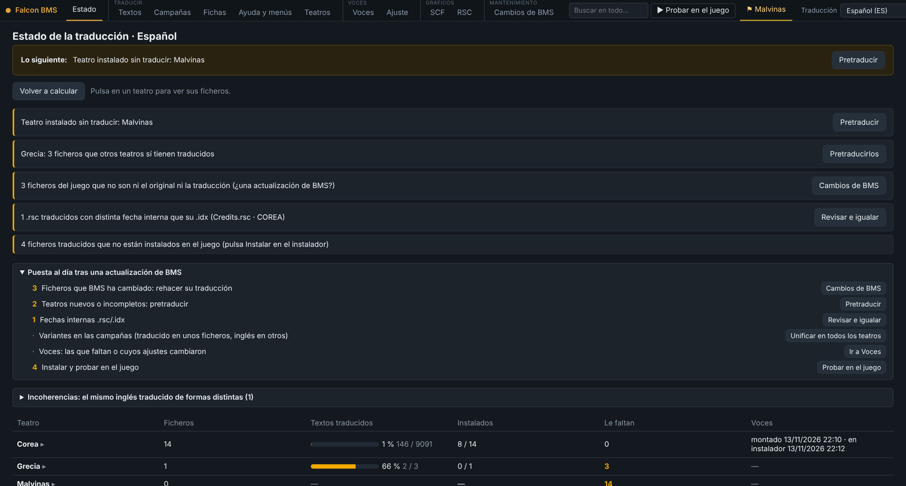
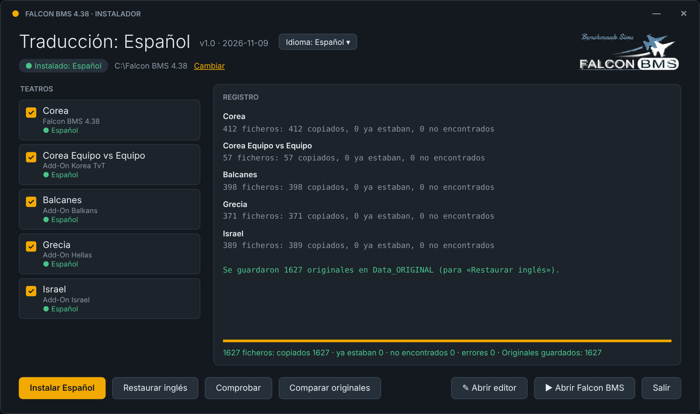
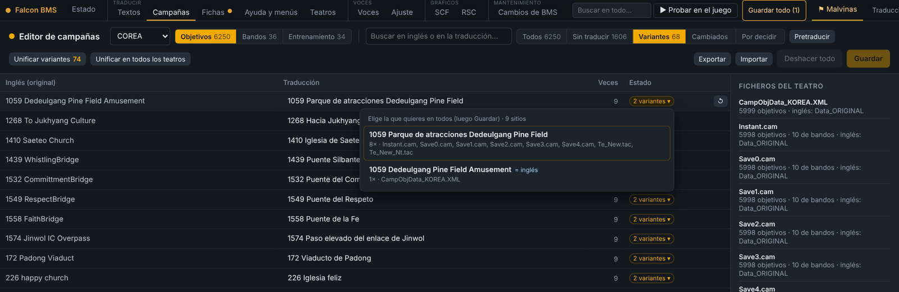
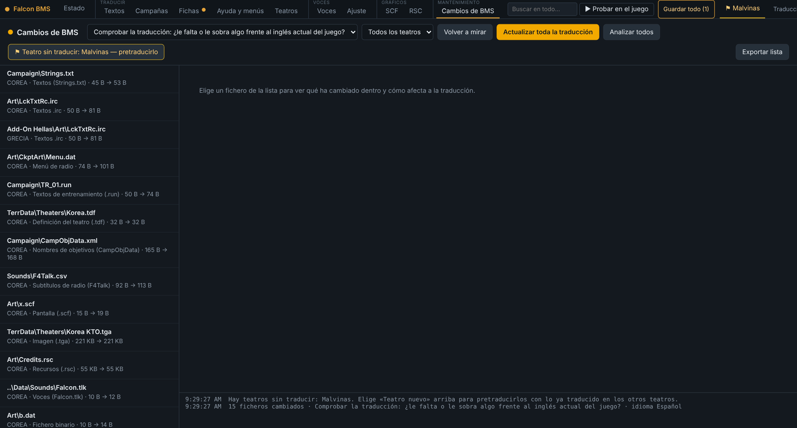
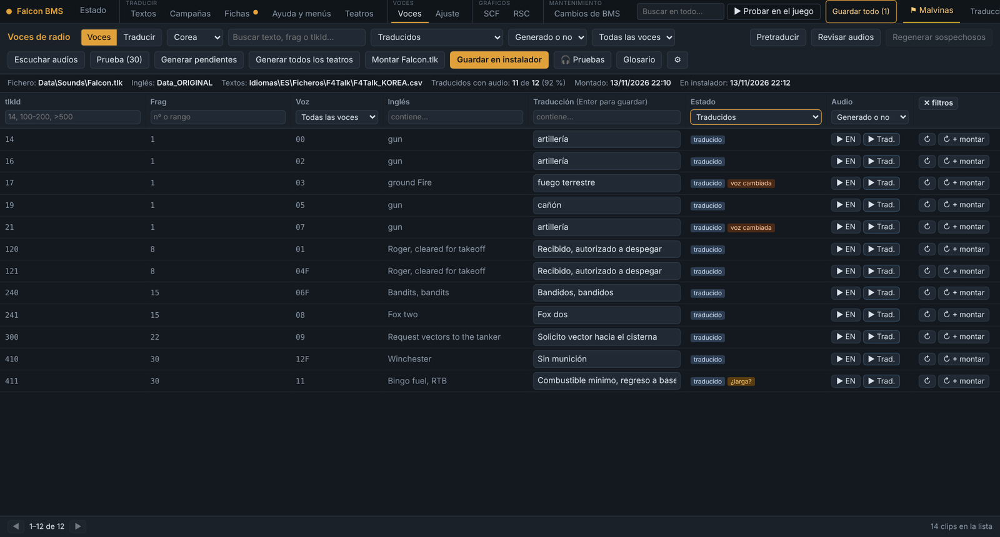
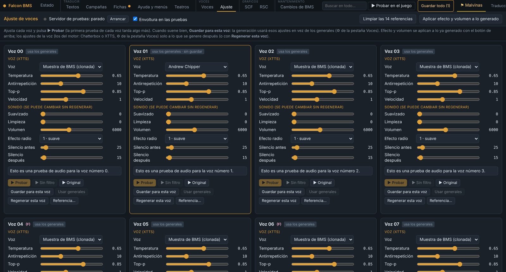

# Herramienta de traducción de Falcon BMS 4.38

**Español** · [English](README.en.md)

Herramientas para traducir **Falcon BMS 4.38** a cualquier idioma y para instalar esa traducción en el juego:

- **Instalador:** pone y quita una traducción en Falcon BMS teatro a teatro, sin tocar nada más del juego.
- **Editor:** crea y mantiene la traducción: menús, textos, fichas, campañas, imágenes y voces de radio.

El paquete **no incluye ninguna traducción**. Se crea una con el editor o se añade una ya hecha en la carpeta `Idiomas` (ver [Dónde va cada traducción](#dónde-va-cada-traducción)).

Funciona con los cinco teatros del juego (**Corea**, **Corea Equipo vs Equipo**, **Balcanes**, **Grecia** e **Israel**) y con cualquier teatro nuevo instalado como `Data\Add-On <Nombre>`, también los que usan un `.tdf` `_NT` (por ejemplo, Mideast128).



---

## Índice

- [Requisitos](#requisitos)
- [Contenido](#contenido)
- [Dónde va cada traducción](#dónde-va-cada-traducción)
- [Instalador](#instalador)
- [Editor](#editor)
- [Cuando sale una actualización de BMS](#cuando-sale-una-actualización-de-bms)
- [Un teatro nuevo](#un-teatro-nuevo-add-on-sin-traducir)
- [Voces de radio](#voces-de-radio-opcional)
- [Copias de seguridad y ficheros propios del equipo](#copias-de-seguridad-y-ficheros-propios-del-equipo)
- [Repartir tu traducción](#repartir-tu-traducción)
- [Licencias y avisos](#licencias-y-avisos)

---

## Requisitos

- **Falcon BMS 4.38** instalado.
- Windows 10 u 11 (usa PowerShell 5, incluido en Windows).
- Solo para generar voces de radio: tarjeta **NVIDIA** con CUDA (recomendable 8 GB o más), unos 8 GB libres e internet la primera vez.

---

## Contenido

```
├── Instalar.bat                  Abre el instalador
├── LEEME.txt                     Primeros pasos
├── Instalador/
│   ├── Instalador.ps1            Instalador (ventana)
│   ├── Idiomas.ps1               Idiomas de la traducción (lo usan el instalador y el editor)
│   ├── Teatros.ps1               Teatros: los conocidos, cualquier «Add-On» nuevo y sus carpetas según el .tdf
│   ├── logo.png                  Logo de la ventana (opcional; se puede cambiar)
│   ├── Revisar_redundantes.bat   Lista los ficheros traducidos idénticos al original
│   └── Retirar_redundantes.bat   Los retira del idioma (con copia de seguridad)
└── Editor_BMS/
    ├── Editor_BMS.bat            Abre el editor
    ├── Crear_distribucion.bat    Crea el zip para repartir la herramienta con tus traducciones
    ├── Crear_paquete.bat         Crea un zip solo con el editor
    └── Voces/                    Kit de voces de radio (scripts y mapas de clips)
```

Al usarlo se crean además:

- `Idiomas\`: las traducciones (las crea el editor o las copias tú).
- `Data_ORIGINAL\`: los originales en inglés de los ficheros traducidos. Los guarda el instalador la primera vez y sirven para volver al inglés.
- `Editor_BMS\Respaldo\`, `Editor_BMS\memoria_<IDIOMA>.json` y `Editor_BMS\cache_huellas.txt`: copias de seguridad y cachés del editor (ver [más abajo](#copias-de-seguridad-y-ficheros-propios-del-equipo)).

---

## Dónde va cada traducción

Cada traducción es una carpeta dentro de `Idiomas`, con el código del idioma (dos o tres letras):

```
Idiomas/
├── actual.txt               Idioma elegido (lo escriben el instalador y el editor)
├── ES/
│   ├── idioma.json          Código, nombre, idioma de las voces y codificación
│   ├── Archivos.csv         Qué fichero traducido va a qué sitio del juego
│   ├── glosario.txt         (opcional) Términos fijos y textos que se quedan igual que en inglés
│   ├── pronunciaciones.txt  (opcional) Palabras que la voz dice mal
│   └── Ficheros/            Ficheros traducidos
└── PT/ …                    Otros idiomas, con la misma estructura
```

- **Para añadir una traducción ya hecha:** copia su carpeta (por ejemplo `ES`) dentro de `Idiomas`, junto a `Instalar.bat`. Si la carpeta `Idiomas` no existe, créala. El instalador y el editor la encuentran solos.
- **Para tener varias:** una carpeta por idioma. Se elige cuál instalar con el botón **Idioma** del instalador.
- **Formato antiguo:** si la traducción trae `Archivos.csv` y `Ficheros` sueltos junto al instalador, se trata como el español y el instalador propone pasarla a `Idiomas\ES`.

### `idioma.json`

```json
{ "codigo": "PT", "nombre": "Português", "voz": "pt", "codificacion": 1252,
  "lectura": { "basicos": "zero,um,dois,…", "decenas": "vinte,trinta,…", "union": " e ", "decimal": "vírgula", … } }
```

- **nombre:** el nombre del idioma en su propio idioma; es el que se ve en el instalador y en el editor.
- **voz:** idioma del motor de voz (es, pt, fr, it, de…).
- **codificacion:** página de códigos de los textos del juego (1252 sirve para español, portugués, francés, italiano o alemán).
- **lectura:** cómo se leen en voz alta los números, las siglas y los decimales. Se edita desde el editor.

### `Archivos.csv`

Cada línea indica qué fichero traducido va a qué sitio del juego:

```
Teatro;Ficheros;Data
COREA;RSC\Art\_FHD\Main.rsc;Art\_FHD\Main.rsc
BALCANES;LckTxtRc.irc + LckTxtRc\Cambios_BALCANES.irc;Add-On Balkans\Art\_FHD\LckTxtRc.irc
```

- **Teatro:** COREA, TVT, BALCANES, GRECIA, ISRAEL o la clave de un teatro nuevo (`Add-On Malvinas` → `MALVINAS`).
- **Ficheros:** ruta dentro de la carpeta `Ficheros` del idioma.
- **Data:** ruta relativa a `Falcon BMS 4.38\Data`. Si empieza por `..\`, es relativa a la carpeta de Falcon BMS.
- **«base + cambios»:** instala la base con las líneas `[ADDTEXT]` del fichero de cambios aplicadas encima. Así, un texto común se traduce una vez para todos los teatros.

El editor mantiene este fichero solo: al guardar algo, añade su línea si falta.

### `glosario.txt`

```
guns = cañones | cañón
howitzer = obús
Kosovo = Kosovo
```

Cómo se traduce siempre cada término (Voces y Fichas marcan los textos que no lo usan). Una línea con el inglés igual a la traducción marca un texto que **se queda igual a propósito**: deja de contar como «sin traducir» en todas las pestañas.

---

## Instalador



1. **Cierra Falcon BMS** (con el juego abierto no instala ni restaura).
2. Ejecuta **`Instalar.bat`**.
3. Comprueba la carpeta de Falcon BMS (la detecta sola; si no, pulsa **Cambiar**).
4. Elige el idioma con **Idioma**, marca los teatros y pulsa **Instalar** (el botón lleva el nombre del idioma).

Para volver al inglés, pulsa **Restaurar inglés**. Desde el editor, **▶ Probar en el juego** hace estos pasos por ti.

Cómo funciona:

- **Guarda los originales:** antes de sustituir un fichero, guarda el original en inglés en `Data_ORIGINAL`. No hace falta descargar nada aparte para volver al inglés.
- **Solo copia lo que cambia:** los ficheros que ya están igual aparecen como «ya estaba».
- **Sabe qué hay instalado:** muestra el estado de cada teatro (*idioma*, *inglés*, *mezcla* u *otro idioma*). **Comprobar** revisa `Archivos.csv` y las carpetas sin copiar nada.
- **Cambia de idioma limpiamente:** al instalar un idioma, lo que otro hubiera instalado en esos teatros y este no trae vuelve antes al original.
- **Detecta actualizaciones de BMS:** si una actualización cambia un fichero traducido, guarda el nuevo original y avisa. **Comparar originales** lo comprueba sin tocar nada.
- **Protege los `.rsc`:** no instala un `.rsc`/`.idx` traducido que no encaje con su pareja (el juego se cerraría al cargar ese menú), y **Comprobar** marca en rojo los que no cuadran.
- **Reconoce teatros nuevos:** cualquier carpeta `Data\Add-On <Nombre>` con pinta de teatro aparece en la lista; sus carpetas se leen de su `.tdf`.
- **Deja registro:** la última operación queda en `Instalador\Registro.log`.
- **Actualización de BMS…** abre un asistente con los pasos de [Cuando sale una actualización de BMS](#cuando-sale-una-actualización-de-bms), cada uno con su botón, y recuerda por cuál vas.

`Revisar_redundantes.bat` lista los ficheros traducidos que son idénticos al original (no hace falta instalarlos) y `Retirar_redundantes.bat` los aparta a `Ficheros\_retirados` y quita su línea de `Archivos.csv`, guardando antes una copia.

Si Falcon BMS está en una carpeta protegida (por ejemplo, «Archivos de programa»), abre `Instalar.bat` con clic derecho → **Ejecutar como administrador**.

---

## Editor

`Editor_BMS\Editor_BMS.bat` (o **Abrir editor** en el instalador) abre el editor en el navegador. Detecta solo Falcon BMS y el instalador, y lo que guardas va directamente al idioma del instalador: el fichero editado a `Ficheros`, el original a `Data_ORIGINAL` y la línea a `Archivos.csv`. Los ficheros idénticos al original no se copian. Solo puede haber un editor abierto a la vez.

El interruptor **ES | EN** cambia el idioma de la interfaz del editor. El desplegable **Traducción** elige qué idioma se edita; **＋ Nuevo idioma…** crea uno partiendo de los originales en inglés y **⚙** abre sus ajustes (voz, codificación, lectura de números y siglas, pronunciaciones). Hay plantillas para español, portugués, francés, italiano y alemán.

### Pestañas

| Grupo | Pestaña | Para qué sirve |
|---|---|---|
| | **Estado** | Portada: resumen por teatro, avisos con su botón, «Lo siguiente», puesta al día tras una actualización, incoherencias y copias de seguridad. |
| Traducir | **Textos** | `Campaign\Strings.txt` de todos los teatros a la vez. Vista **Por ID** o **Por inglés** (una fila por texto inglés, aunque esté en varios IDs). |
| | **Campañas** | Nombres de objetivos (en los `.cam`/`.tac` y en el `CampObjData.XML` a la vez), bandos y textos de los entrenamientos. |
| | **Fichas** | Base de datos táctica (`TerrData\TacRefDB.xml`): nombre, categorías, descripción y radar. Exportar/importar a `.csv` o `.txt` con marcas `[[ID]]`. |
| | **Ayuda y menús** | Interfaz (`LckTxtRc.irc`), guía (`GuideTxt.irc`), ayudas emergentes (`HelpText.irc`) y menú de radio (`Menu.dat`). |
| | **Teatros** | Nombre, descripción y portada (`.tdf`/`.tga`) y, del `Theater.irc`, países, bandos y campañas. |
| Voces | **Voces** | Escuchar original y traducción, corregir subtítulos (`F4Talk.csv`), generar con IA y montar el `Falcon.tlk`. |
| | **Ajuste** | Ajustar y probar cada una de las 14 voces. |
| Gráficos | **SCF** | Vista previa de las pantallas del juego: mover elementos y cambiar textos para que quepan. |
| | **RSC** | Recursos de los `.rsc`: imágenes, textos, sonidos y créditos. |
| Mantenimiento | **Cambios de BMS** | Qué ha cambiado una actualización **dentro** de cada fichero traducido y rehacer la traducción sobre el original nuevo. |

### Para trabajar más rápido

- **Buscar en todo** (arriba): busca un texto, en inglés o en la traducción, en todas las pestañas y teatros (también en los `Cambios_<TEATRO>.irc`); un clic abre la pestaña con la búsqueda puesta.
- **▶ Probar en el juego:** guarda lo pendiente, mira qué teatros tienen algo distinto de lo instalado y abre el instalador con esos teatros marcados para instalarlos. Si el instalador ya estaba abierto, no instala y avisa de qué teatros marcar en él.
- **Guardar todo (n):** guarda a la vez todas las pestañas con cambios (marcadas con **●**). En pantallas estrechas la barra se compacta («Probar en el juego» queda como ▶ y «Guardar todo» como «Guardar»).
- **Memoria de traducción:** el Estado reúne todos los pares inglés → traducción (`Editor_BMS\memoria_<IDIOMA>.json`). **Pretraducir** (Textos, Fichas, Campañas, Voces) rellena lo que sigue en inglés con lo ya traducido en otro teatro o pestaña, y lo deja marcado para revisar. El Estado lista las **incoherencias** (el mismo inglés traducido de formas distintas; las diferencias solo de mayúsculas o tildes no cuentan): al pulsar la traducción buena, se pone en todos los ficheros traducidos donde ese inglés tenía otra (Textos, Fichas, Ayuda y menús, Teatros y subtítulos de Voces), con copia antes en `Respaldo\Antes_de_unificar_<fecha>`. Solo se toca la traducción; respeta las mayúsculas y quita las tildes en el menú de radio. En Campañas se elige con su propio selector de variantes.
- **Variantes:** cuando un texto está traducido de formas distintas, **N variantes ▾** las enseña y deja elegir la buena para todos los sitios. **Unificar variantes** (y Guardar, automáticamente) arregla las del tipo «traducido en unos sitios, inglés en otros»; las demás quedan en el filtro **Por decidir**.

  

- **Textos que se quedan igual que en inglés:** los que solo tienen números, códigos (`#DB0`, `%s`) o designaciones (`F-16C`, `SA-10`) no cuentan como «sin traducir»; los demás se marcan con **✓ igual** y la marca va al glosario.
- **Teclado:** **Intro** guarda y salta a la siguiente fila o campo sin traducir; **Mayús+Intro**, hacia atrás; en las descripciones de Fichas, **Ctrl+Intro**.
- **Fechas `.rsc`/`.idx`:** cada pareja lleva una fecha interna. Al abrir el Estado, las que encajan pero tienen fechas distintas se igualan solas (con copia antes). Las que no encajan, o las que llevan la fecha de un original anterior de BMS (en `Data_ORIGINAL\_anteriores`, es decir, traducciones de la versión vieja), se avisan para rehacerlas en Cambios de BMS.
- **Carpetas según el `.tdf`:** el editor lee `campaigndir`, `artdir` y `sounddir` del `.tdf` activo (el de `theater.lst`; si hay varios, el `_NT`). Si una carpeta está fuera del Add-On (p. ej. `sounddir Sounds` en Mideast128), el teatro comparte esos ficheros con Corea: no se le generan voces aparte ni se duplican en el instalador.
- **Más rápido:** el Estado recuerda lo contado y solo vuelve a leer lo que cambia; las huellas de los ficheros se guardan entre sesiones (`cache_huellas.txt`).

---

## Cuando sale una actualización de BMS

Las actualizaciones de BMS pueden cambiar ficheros que tienes traducidos. Si se instala la traducción antigua encima, esos cambios se pierden. Para evitarlo:

1. En el instalador, pulsa **Restaurar inglés** (el juego vuelve a los originales y el actualizador de BMS los reconoce).
2. Actualiza Falcon BMS.
3. En el instalador, **Comparar originales** lista qué ficheros traducidos ha cambiado BMS, sin tocar nada.
4. Pulsa **Instalar**: guarda los originales nuevos en `Data_ORIGINAL` y los anteriores en `Data_ORIGINAL\_anteriores\<fecha>`.
5. Abre el editor: el **Estado** muestra **Puesta al día tras una actualización de BMS** con lo que falta y un botón por paso. El principal es **Cambios de BMS → Actualizar toda la traducción**, que rehace sobre el original nuevo todo lo que se puede rehacer solo (conserva tus traducciones, deja en inglés lo nuevo y recoge los demás cambios) y lista lo que queda a mano.
6. Pulsa **▶ Probar en el juego** y revisa en cada pestaña el filtro «Sin traducir».

El botón **Actualización de BMS…** del instalador te lleva por estos pasos y, en el 5, abre el editor en el Estado.



| Ficheros | En «Cambios de BMS» |
|---|---|
| `Strings.txt`, `.irc` (también `LckTxtRc` con base + cambios), `Menu.dat`, `.run`, `.tdf`, `CampObjData.xml`, `F4Talk.csv` | Textos nuevos, cambiados y quitados; se rehacen. |
| `TacRefDB.xml` | Fichas emparejadas por número; se rehace. |
| `.cam`, `.tac`, `.trn` | Nombres de objetivos y bandos; se rehacen sobre el fichero nuevo. Si falta el inglés de antes, los objetivos toman la traducción del `CampObjData.XML` o de la memoria de traducción. |
| `.scf` | Diferencias por líneas; se aplican donde no hayas tocado el fichero. |
| `.rsc` | Parte del `.rsc` nuevo y le copia tus imágenes traducidas que BMS no ha cambiado; lista las que hay que reimportar. |
| `.tga` | Las portadas una al lado de otra. |
| `Falcon.tlk` | Clips cambiados, nuevos y quitados; se vuelve a montar en Voces. |

---

## Un teatro nuevo (Add-On sin traducir)

El instalador y el editor detectan solos cualquier `Data\Add-On <Nombre>`. Si la traducción aún no tiene nada de ese teatro, el editor muestra arriba **⚑ <teatro>** y el Estado lo pone como «Lo siguiente». **Pretraducir todo el teatro** (en Cambios de BMS):

- los ficheros cuyo inglés es idéntico al de un teatro ya traducido usan esa misma traducción: solo se añade su línea a `Archivos.csv`;
- los demás se crean para el teatro nuevo con la traducción de lo que dice lo mismo en otro teatro; lo distinto se queda en inglés;
- los textos de la interfaz (`LckTxtRc`) usan la base común y lo propio del teatro va a su `Cambios_<TEATRO>.irc`;
- se pretraducen los subtítulos de radio, los textos y las fichas (quedan sin guardar, para revisarlos);
- al final lista lo que falta a mano: campañas (con **Pretraducir** desde la memoria), `Theater.irc`, `.tdf` y portada.

---

## Voces de radio (opcional)



Las voces se generan en local con uno de estos dos motores, a elegir en la rueda (⚙) de la pestaña **Voces**:

- **[XTTS-v2](https://huggingface.co/coqui/XTTS-v2)** ([coqui-tts](https://github.com/idiap/coqui-ai-TTS)), licencia no comercial. **Motor por defecto:** en las pruebas falla en un 2-3 % de las frases cortas, frente a casi un 20 % de Chatterbox.
- **[Chatterbox Multilingual](https://huggingface.co/ResembleAI/chatterbox)** (Resemble AI, licencia **MIT**).

Cada una de las 14 voces originales se clona a partir de sus propias frases del `Falcon.tlk` en inglés, y se sintetiza el texto traducido del `F4Talk.csv` del idioma.

1. **Preparar entorno…** instala en `Editor_BMS\Voces` Python 3.11, el motor, ffmpeg, el modelo y Whisper, y crea las **referencias de voz** (`Voces\ref`) con las frases más limpias de cada voz del `Falcon.tlk` original de Corea.
2. **Ajuste:** prueba y ajusta cada voz. Con XTTS, cada voz puede usar en vez de su muestra una **voz de serie** del modelo (sin audio de ejemplo), y se ajustan temperatura, **antirrepetición**, **top-p** y velocidad. Si cambias una voz, la pestaña Voces avisa de qué audios se hicieron con los ajustes anteriores y ofrece **Regenerar estas voces**.

   

3. **Generar pendientes** (o **Generar todos los teatros**): se puede cortar y reanudar, y admite varios procesos en paralelo.
4. **Revisar audios** marca los que duran mucho menos o mucho más de lo esperado; **Escuchar audios** los escucha con [Whisper](https://github.com/openai/whisper) y marca los que no dicen su texto (repeticiones, coletillas); **Regenerar sospechosos** los rehace. Con **⚙ → Comprobar cada audio al generar**, se escucha cada audio al generarlo y se repite si no sale limpio.
5. **Frases cortas:** los textos de hasta 12 letras se generan dentro de una frase del idioma («Atención, repito: cañones.») y luego se recorta solo el texto, porque así el motor inventa menos.
6. **Montar Falcon.tlk** y **Guardar en instalador:** el `Falcon.tlk` montado pasa a `Ficheros`, como cualquier otro fichero traducido.

Un mismo texto con la misma voz se sintetiza una sola vez y se reutiliza en todos sus clips y teatros (enlaces duros), y montar solo vuelve a codificar lo nuevo. Más detalles en `Editor_BMS\Voces\LEEME.txt`.

---

## Copias de seguridad y ficheros propios del equipo

- **`Editor_BMS\Respaldo\Sesion_<fecha>\`:** antes de sobrescribir un fichero de `Ficheros` por primera vez en una sesión, el editor guarda una copia. Las sesiones de más de 30 días se borran solas (quedan siempre las 5 últimas); el Estado muestra cuánto ocupan y permite borrarlas. Rehacer en Cambios de BMS guarda además `Antes_de_rehacer_<fecha>`.
- **`Editor_BMS\memoria_<IDIOMA>.json`:** memoria de traducción. Se rehace sola si se borra.
- **`Editor_BMS\cache_huellas.txt`:** huellas de los ficheros para no volver a leerlos. Se rehace sola.

Ninguno de estos va en el zip de distribución.

---

## Repartir tu traducción

- **`Editor_BMS\Crear_distribucion.bat`** crea `Traduccion_BMS_<versión>.zip` junto a la carpeta, con el instalador, el editor y los idiomas de `Idiomas`. Deja fuera lo propio de tu equipo: `Data_ORIGINAL`, copias de seguridad, registros, el entorno de voces, cachés, audios intermedios y tus ajustes. No cambia nada de tu carpeta.
- Para repartir solo la traducción, basta con su carpeta de `Idiomas` (por ejemplo `Idiomas\ES`): quien la reciba la copia en su `Idiomas`.
- **`Editor_BMS\Crear_paquete.bat`** crea un zip solo con el editor.

Si en la carpeta del instalador hay un `version.txt`, el instalador muestra su primera línea junto al título.

---

## Licencias y avisos

- **Falcon BMS** es obra de **Benchmark Sims**. Esta herramienta no es oficial ni está respaldada por ellos. Los ficheros del juego, sus textos, imágenes y sonidos, así como el logotipo de Falcon BMS (`Instalador\logo.png`), pertenecen a sus autores. La herramienta no incluye ficheros del juego; los mapas de clips del kit de voces (`Voces\Mapas`) llevan el texto en inglés de cada clip para poder cruzarlo con la traducción.
- **XTTS-v2** (motor por defecto) se distribuye bajo la **Coqui Public Model License (CPML)**, de **uso no comercial**. Cada usuario lo descarga y acepta su licencia al preparar el entorno. Las voces generadas con él no deben usarse con fines comerciales.
- **Chatterbox** (Resemble AI) se distribuye bajo licencia **MIT**. Todo el audio que genera lleva una marca de agua inaudible (PerTh) que permite identificarlo como sintético.
- **Whisper** (OpenAI) se distribuye bajo licencia **MIT**.
- **ffmpeg** se descarga de [gyan.dev](https://www.gyan.dev/ffmpeg/builds/) y tiene su propia licencia.
- El código del instalador y del editor puede usarse y modificarse libremente para fines no comerciales relacionados con Falcon BMS.
